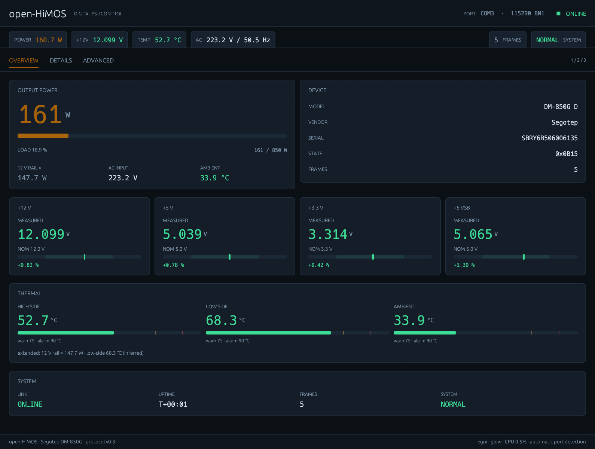
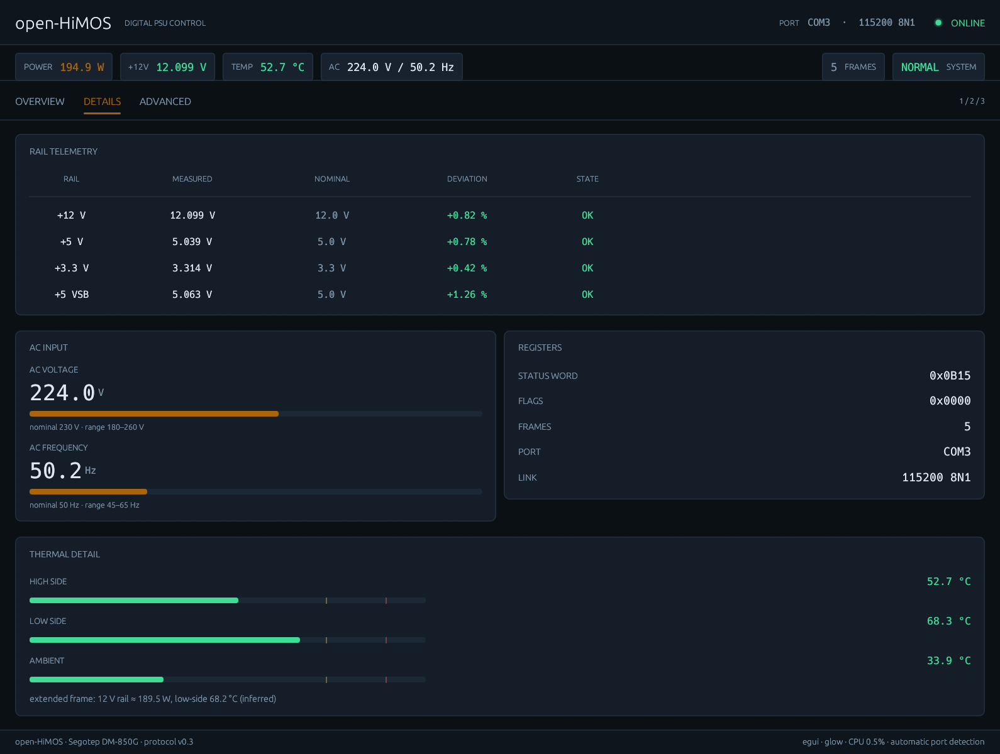
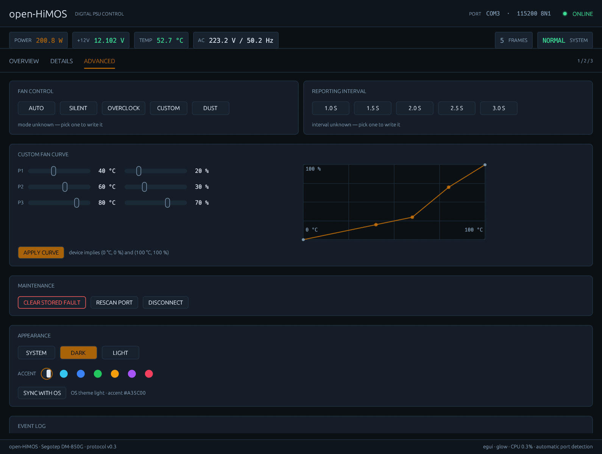
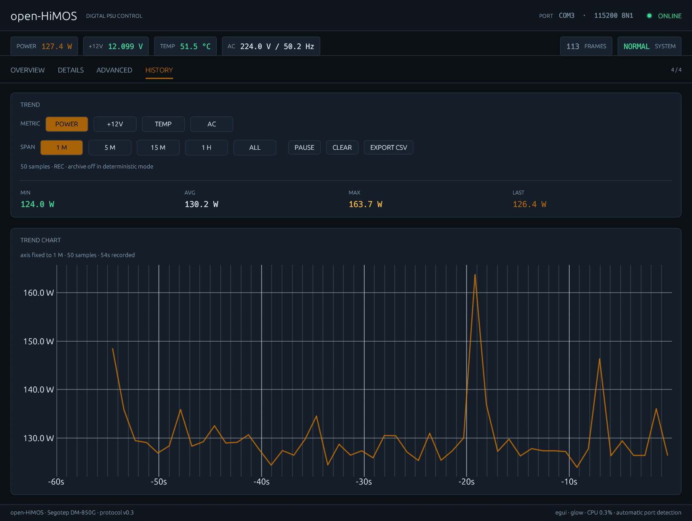
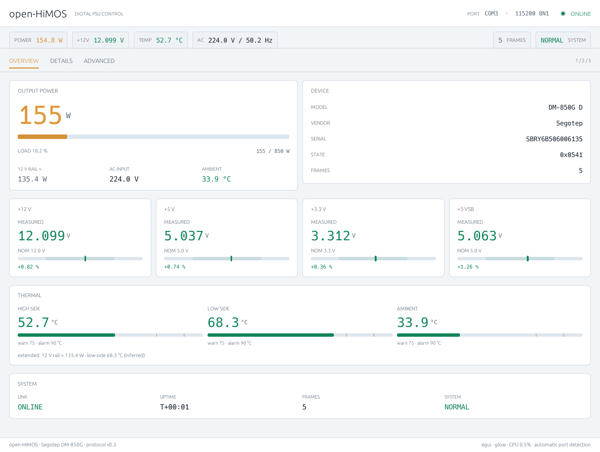
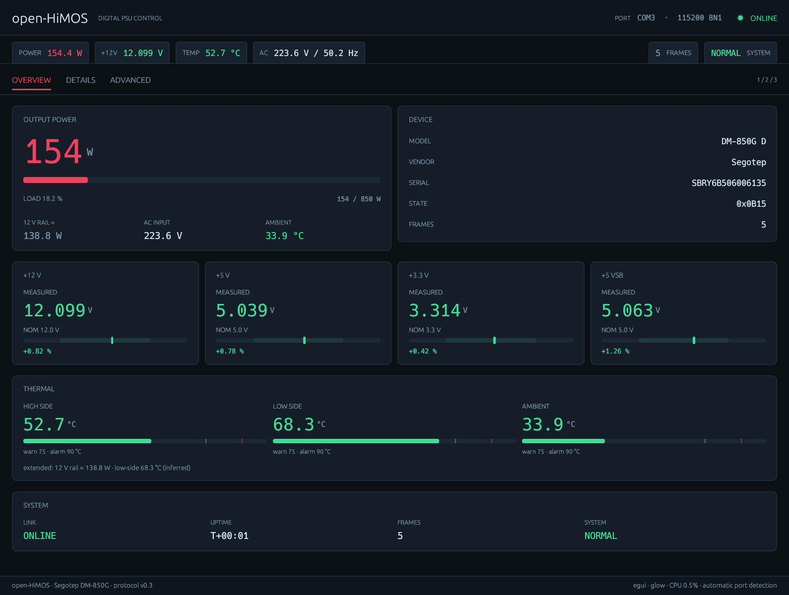

# open-HiMOS

[](https://github.com/fdkevin0/open-HiMOS/actions/workflows/ci.yml)

Open-source Rust controller for Segotep DM-series digital PSUs, with the **DM-850G** as the
primary target. One protocol core, two front ends: a progressive-disclosure desktop GUI and a
scriptable CLI. Windows and Linux are supported.

This project exists because the vendor's Windows client is closed and Windows-only. The wire
protocol was recovered from runtime observation (see [protocol notes](docs/protocol-dm850g.md))
and is implemented here as a typed, tested Rust library.

## Quick start

Requirements: Rust stable (MSRV 1.85), a CH340 USB-serial driver, and a supported PSU.

```bash
cargo test --all                      # protocol golden vectors + unit tests
cargo run -p himos-cli -- selftest    # offline replay of captured frames
cargo run -p himos-cli -- ports       # list serial ports, mark the detected PSU
cargo run -p himos-cli -- monitor     # auto-detect and read telemetry
cargo run -p himos-gui                # desktop GUI (auto-connects)
```

Close the official HiMOS client first: it owns the serial port. The GUI re-scans every two
seconds, so unplug/replug does not require restarting it.

## What it does

- **Read-only telemetry**: +3.3 V / +5 V / +12 V / +5 VSB, total power, AC voltage/frequency,
  three temperatures.
- **Control**: fan mode (auto/silent/overclock/custom/dust), reporting interval, custom fan curve,
  clear stored fault.
- **Progressive disclosure**: Overview (three headline numbers) → Details (every measurement) →
  Advanced (write commands + event log) → History (recorded telemetry and trend chart).
- **Scope**: digital-PSU capabilities only. No host CPU/GPU telemetry, no LCD or pump-screen
  integration.

## Screenshots



<details>
<summary>More screenshots: details, advanced, history, themes</summary>

**Details** — every measurement, AC input, registers, thermal breakdown.



**Advanced** — fan control, interval, custom curve, maintenance, appearance, event log.



**History** — fixed-scale trend chart (default 1 h), window statistics, CSV export.



**Light theme** — follows the OS appearance and accent colour.



**Custom accent** — `--accent rose` overrides the OS accent for one run.



Screenshots are rendered by the application itself and can be reproduced on any machine:

```bash
cargo run -p himos-gui -- --screenshot docs/gui-overview.png --theme dark
cargo run -p himos-gui -- --screenshot docs/gui-overview-light.png --theme light
cargo run -p himos-gui -- --screenshot docs/gui-history.png --level history --history-span 1m --settle 55
cargo run -p himos-gui -- --help
```

</details>

## Interfaces

### CLI

| Command | Purpose |
| --- | --- |
| `himos ports` | enumerate serial ports and mark the detected PSU |
| `himos monitor` | auto-detect, stream parsed telemetry (optionally write fan mode/curve) |
| `himos calibrate` | controlled-load calibration for the extended (0x04) frame |
| `himos selftest` | offline replay of captured frames; no hardware needed |

<details>
<summary>CLI options</summary>

`himos monitor` accepts `--port` (manual override; auto-detection is the default), `--seconds`,
`--fan-mode`, `--interval`, `--curve`, `--clear-fault`, and `--no-init`. `himos calibrate` accepts `--port`,
`--idle`, `--load`, `--tail`, and `--csv`. Run `himos --help` / `himos <command> --help` for
exact defaults.

</details>

### GUI

```text
himos-gui [OPTIONS]

  --port <NAME>          serial port override (default: autodetect CH340)
  --level <PAGE>         overview | details | advanced | history
  --theme <MODE>         system | dark | light (default: follow OS)
  --accent <NAME>        auto | cyan | blue | green | amber | violet | rose
  --history-span <SPAN>  1m | 5m | 15m | 1h | all (fixed x axis, default: 1h)
  --data-dir <PATH>      config/history directory (default: per-user, writable fallback)
  --smoke <SECONDS>      connect, print frame stats, exit (1 when no frame arrived)
  --screenshot <PATH>    render one frame to PNG, then exit
  --settle <SECONDS>     wait before taking the screenshot
  -h, --help             show help

Keys: 1/2/3/4 pages · F11 fullscreen · Esc exit fullscreen
```

`--smoke` and `--screenshot` are deterministic self-test hooks used by CI and documentation; they
do not write the history archive and ignore saved window geometry.

## How it is organised

| Crate | Responsibility |
| --- | --- |
| [`crates/himos-core`](crates/himos-core) | protocol core: framing, CRC, DM-850G fields, commands, serial transport — no GUI dependency |
| [`crates/himos-cli`](crates/himos-cli) | `himos` CLI: monitor / calibrate / ports / selftest |
| [`crates/himos-gui`](crates/himos-gui) | egui/eframe desktop panel with four disclosure levels |

The GUI keeps the serial port on a worker thread and communicates through channels; all state
shared with the UI is copyable values, so there are no locks on the paint path. The protocol
library is `no_std`-agnostic in spirit: it performs no I/O itself except in the `transport`
module.

## Documentation

| Document | Read it when you want to… |
| --- | --- |
| [Protocol: DM-850G](docs/protocol-dm850g.md) | understand frames, fields, commands, and what is still unknown |
| [Verification](docs/verification.md) | see the hardware and CI evidence behind the implementation |
| [Driver download](docs/driver-download.md) | install the CH340 driver on Windows |
| [Lint configuration](docs/lint-config.md) | review how BeautifulRust lints are wired into the workspace |

<details>
<summary>Design notes and evidence</summary>

- **Theme**: dual dark/light palettes; follows OS appearance on Windows and macOS, reads the
  system accent colour where the OS exposes one, and persists the user's choice. Details in
  [`crates/himos-gui/src/theme.rs`](crates/himos-gui/src/theme.rs).
- **History**: 1 Hz ring buffer (2 h in memory) plus a rotating CSV archive; `egui_plot` renders
  a fixed-scale time axis. Details in [`crates/himos-gui/src/history.rs`](crates/himos-gui/src/history.rs).
- **Window management**: native decorations, Snap Layouts, per-monitor DPI v2, geometry
  persistence, F11/Esc fullscreen. Details in [`crates/himos-gui/src/window.rs`](crates/himos-gui/src/window.rs).
- **Rendering**: eframe glow (OpenGL 2.0+) with vsync, `HardwareAcceleration::Preferred`;
  measured CPU is ~0.5% at 2 Hz telemetry.

</details>

## Development

```bash
cargo fmt --all -- --check
cargo clippy --all-targets --all-features -- -D warnings
cargo test --all
cargo doc -p himos-core --no-deps
```

Linux GUI builds need `pkg-config libudev-dev libxkbcommon-dev libwayland-dev libx11-dev
libxcursor-dev libxrandr-dev libxi-dev` (see [CI](.github/workflows/ci.yml)).

Rust style follows [BeautifulRust](https://github.com/morganlinton/BeautifulRust): the root
`clippy.toml` and `[workspace.lints]` are the effective configuration. The upstream skill files are
a local development aid and are not vendored in this repository.

See [CONTRIBUTING.md](CONTRIBUTING.md) for the contribution workflow.

## License

Licensed under either of

- Apache License, Version 2.0 ([LICENSE-APACHE](LICENSE-APACHE))
- MIT license ([LICENSE-MIT](LICENSE-MIT))

at your option. Unless you explicitly state otherwise, any contribution intentionally submitted
for inclusion in this project by you shall be dual licensed as above, without additional terms.

## Disclaimer

The protocol was obtained for interoperability by observing a device you own. Write commands
change real PSU behaviour (fan mode, fan curve, stored fault); verify each command before relying
on it. Use at your own risk; the authors are not responsible for any damage or loss.

Segotep, HiMOS and DM-850G are trademarks of their respective owners. This project is not
affiliated with or endorsed by Segotep.
